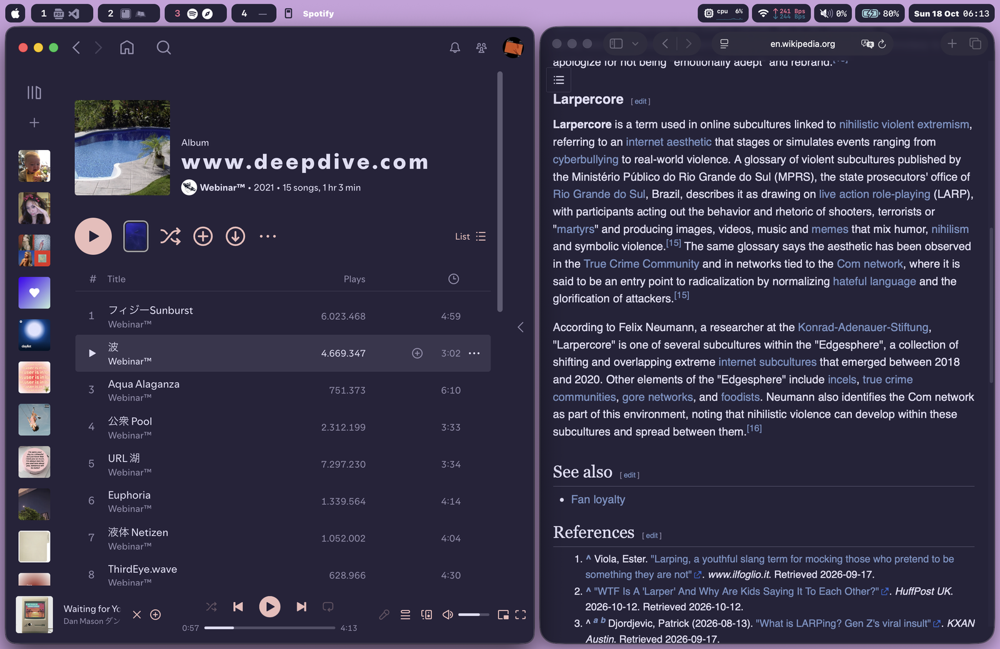
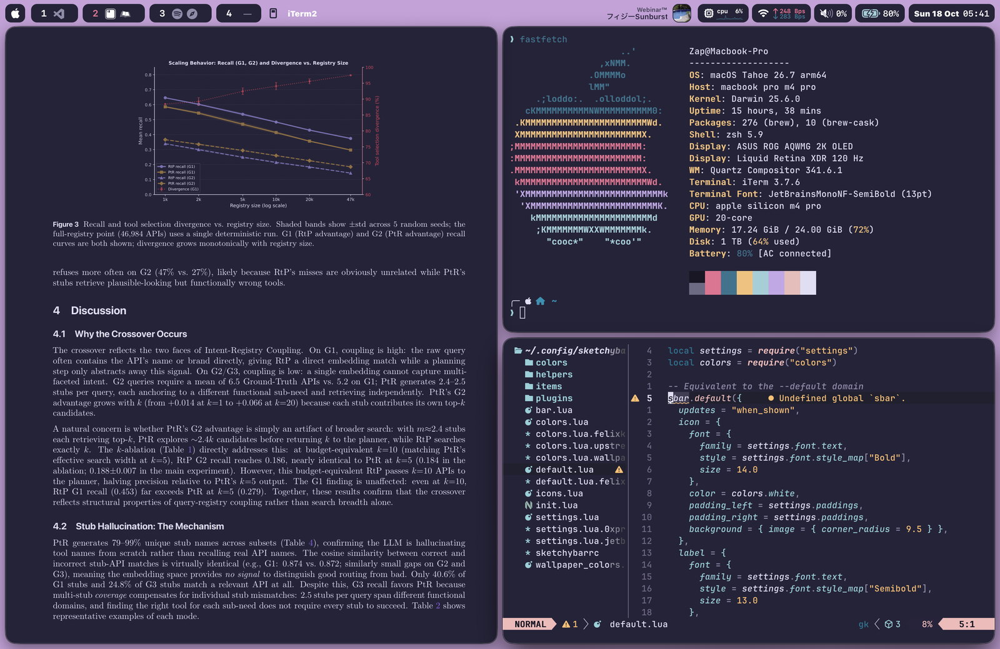

# dotfiles

A macOS desktop in [Rosé Pine](https://rosepinetheme.com), tiled with Amethyst.
Every surface is the same overlay purple — bar, terminal, editor, PDF reader,
Spotify, the browser — so the windows read as one surface rather than a stack
of themed apps.



## The stack

| | | |
|---|---|---|
| Window manager | [Amethyst](https://github.com/ianyh/Amethyst) | [`.amethyst.yml`](.amethyst.yml) |
| Bar | [SketchyBar](https://github.com/FelixKratz/SketchyBar) | [`.config/sketchybar/`](.config/sketchybar/) |
| Window borders | [JankyBorders](https://github.com/FelixKratz/JankyBorders) | [`.config/borders/`](.config/borders/) |
| Shell | zsh · [Starship](https://starship.rs) | [`.zshrc`](.zshrc) · [`.config/starship.toml`](.config/starship.toml) |
| Editor | Neovim (LazyVim) | [`.config/nvim/`](.config/nvim/) |
| Editor | VS Code | [`vscode/settings.json`](vscode/settings.json) |
| PDF | [sioyek](https://sioyek.info), patched | [`.config/sioyek/`](.config/sioyek/) · [`sioyek/`](sioyek/) |
| Music | Spotify via [spicetify](https://spicetify.app) | [`.config/spicetify/`](.config/spicetify/) |
| Browser | Safari, themed by a bundled extension | [`safari-rose-pine/`](safari-rose-pine/) |
| Browser | Chrome, themed by managed policy | [`chrome/`](chrome/) |
| Fetch | fastfetch | [`.config/fastfetch/`](.config/fastfetch/) |

Font is JetBrains Mono Nerd Font throughout. The bar config started as
[FelixKratz/dotfiles](https://github.com/FelixKratz/dotfiles) and diverged.



## Quick start

```sh
brew install sketchybar starship nowplaying-cli
brew install --cask amethyst font-jetbrains-mono-nerd-font
(cd .config/sketchybar/helpers && make)
brew services start sketchybar
```

Then hide the native menu bar and stop title-bar double-click from fighting
the tiler — both in [`docs/setup.md`](docs/setup.md).

## Documentation

- [`docs/rice.md`](docs/rice.md) — why four apps are configured with three
  different hex values for the same colour, and what sioyek needed patching for
- [`docs/setup.md`](docs/setup.md) — install, the measured constants this is
  tuned against, and the bar flags that are not optional
- [`safari-rose-pine/README.md`](safari-rose-pine/README.md) — building and
  signing the Safari extension that themes arbitrary websites

## Caveats

Tuned for one machine: a MacBook Pro `Mac16,8` with an external 2560x1440
display. Bar geometry, notch width and gap arithmetic are measured against
that, not derived — see [`docs/setup.md`](docs/setup.md) before running it on
different hardware.

The Safari extension is signed ad-hoc by default, which Safari will not list.
It needs a Developer ID to persist across launches.
